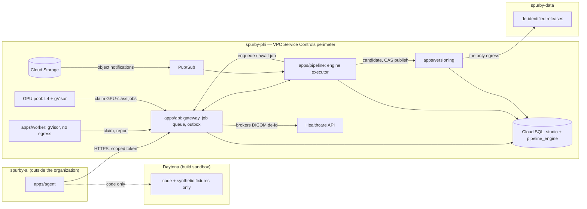

# Pipeline Platform — Architecture and Implementation Specification

**Status:** Proposed architecture, not implemented. Validate the engine and contracts with the
Stage 0 spike (§19) before building on them.
**Date:** 2026-11-01 (revised from the 2026-10-31 draft against the current repo and Google Cloud
layout).
**Primary service:** `apps/pipeline` — Go control plane on **DBOS Transact Go**, a durable-execution
library whose state lives in our own Cloud SQL, behind a thin `Engine` adapter. One engine only; no
orchestration cluster.
**Compute:** `apps/worker` — Python plugin jobs claimed from the kernel job queue (gVisor, no
egress); GPU jobs in a separate pool. Agent-written code never runs on real data outside the worker.
**Version authority:** `apps/versioning` — Go, go-git objects in Postgres, CAS branch heads,
releases, outbox. Already built.
**Placement:** everything in this document runs in the `spurby-phi` Google Cloud project, inside its
VPC Service Controls perimeter (`docs/deployment-gcp.md`).
**Companion specifications:** `versioning.md`, `agent.md`, `plugins.md`, `deployment-gcp.md`,
`todo/todo10.md` (data boundary), `todo/todo11.md` (boot, item lifecycle, derivatives).

> **Fundamental rule:** A pipeline consumes **immutable, pinned inputs** and produces **immutable
> candidate outputs**. The versioning service controls whether those outputs become a published
> dataset version. A live dataset may evolve, but an already-running pipeline must not silently
> change its interpretation of input data.

## 0. Executive decisions

1. **Separation:** `apps/pipeline` is a deployable backend service. `apps/web` contains *only* the
   pipeline editor, status, and approval UI. `apps/api` remains the authenticated public gateway and
   owns the job queue and event outbox. `apps/agent` creates or modifies pipeline proposals through
   authorized API routes. `apps/worker` executes plugin transformations. GPU workloads use dedicated
   compute.
2. **Orchestration:** Durable workflows (retries, timers, cancellation, waiting for human review)
   come from **DBOS Transact Go** (§5.1) behind a thin `Engine` adapter in
   `apps/pipeline/internal/engine/`: no server to run, workflow state in a database on our existing
   Cloud SQL instance, so it stays inside the perimeter under our encryption keys. Only one engine
   runs; the adapter exists so a switch (§5.5) is a replacement, not a rewrite. The engine is not a
   lineage catalog, schema registry, data transform engine, or GPU scheduler; we supply those.
3. **Versions:** `apps/versioning` owns dataset commits, branches, Git objects, semantic merges,
   review requests, and release pointers; pipeline consumes that service's APIs. Do not create
   another branch-head authority in the pipeline database.
4. **Contracts:** Version input/output schemas and field identities. Each step declares required
   input fields, modalities, constraints, outputs, supported schema ranges, and incremental/replay
   semantics.
5. **Messiness is normal:** Always land original inputs in immutable staging; fingerprint and
   classify before promoting. Unknown schema and malformed records generate inspectable errors or
   quarantine artifacts—not silent schema corruption.
6. **Execution isolation:** Code that touches real data runs only in `apps/worker` (GKE Sandbox /
   gVisor, NetworkPolicy denying egress, read-only input) or the browser sandbox. Agent-authored
   code follows the todo10 ladder (§13): built and tested in a build sandbox on synthetic fixtures,
   rebuilt and signed by our worker, checked on real data only through `verify_on_sample` inside the
   worker. Never run untrusted code in engine workers.
7. **Publication:** Create immutable outputs, validate them, stage a candidate commit, then ask the
   versioning service to publish using its PostgreSQL compare-and-swap transaction plus
   transactional outbox. There is no universal ACID transaction across Git, object storage, the
   engine, and PostgreSQL.
8. **Operational goals:** Per-workspace fairness; bounded fan-out; backpressure; idempotent effects;
   quotas, timeouts, incremental recomputation, backfills, cancellation, observability, and
   reconciliation.
9. **Data-sensitive design:** Medical and scientific datasets contain PHI; treat tenancy,
   encryption, audit, provenance, egress restrictions and de-identification as first-class
   requirements. Do not assert regulatory compliance from using any one tool.
10. **Placement:** The pipeline service, its engine state, workers and GPU pool all live in
    `spurby-phi`. The only path out is the de-identified release to `spurby-data` (§9.1). The agent
    in `spurby-ai` only reaches pipeline routes over HTTPS through `apps/api`.

Throughout, **tenant** means the kernel's **workspace** (`workspace_id`); there is no separate
tenant table.

## 1. Existing monorepo and boundaries

The Node 24 + pi agent (`apps/agent`) is the agent runtime; pipeline routes stay agent-neutral
anyway, because external agents reach them through `apps/mcp` too. No `apps/*` direct imports; all
integration is HTTP, events and typed contracts in `packages/contracts`.

### 1.1 What the pipeline reuses

Most of the data plane already exists. `apps/pipeline` coordinates it; it doesn't replace it.

| Concern | Exists today | Pipeline's use |
|---|---|---|
| Job execution | Kernel `JobQueue` (`apps/api/.../kernel/queue.py`, SQL with `SKIP LOCKED`, or Redis); `apps/worker` claims over HTTP (`POST /api/v1/worker/claim`); leases, `max_attempts`, idempotency keys, cancel; KEDA scales the worker | One engine step enqueues a kernel job and waits for `job.succeeded` / `job.failed` (§5.3) |
| Events | Kernel outbox `plugin_events` (`event_id`, `workspace_id`, `type`, `payload`, `payload_ref`, `source`, `correlation_id`, `depth`, `idempotency_key`); SQL or Redis bus; project SSE with `Last-Event-ID` | Pipeline events use the same envelope (§15); `depth` is the trigger-loop guard |
| Ingest | `kernel/imports.py`: chunked uploads to a quarantine prefix, SHA-256, content-addressed `sources/<project>/<sha256>`; worker inspection (`kernel/inspection.py`); todo11 `item.*` lifecycle and derivatives | The implicit ingest pipeline (§6) wraps these steps; it doesn't re-implement them |
| Boundary | todo10 jobs: `fingerprint`, `synthesize_fixtures`, `verify_plugin`, `probe`, `build_plugin`; agent route allowlist `kernel/agent_scope.py` | Agent-authored steps go through them (§13) |
| Versioning | `apps/versioning`: commits with `expected_head` CAS, branches, reviews, semantic merge, releases (with `studio_tree`), outbox (River), GC | Candidate commits and publish (§9); releases gain schema and pipeline revision |
| Storage | `BlobStore` (local, S3, GCS); RustFS in local compose; GCS in production; retention-locked artifacts bucket | Immutable staged outputs, manifests, quarantine reports |
| Databases | Postgres `studio` (api `public` schema via Alembic, `versioning` schema via goose), `agent` database | Pipeline tables in a `pipeline` schema; engine state in its own database (§16) |

**Missing today and needed:** job heartbeats that renew the lease (progress only reports a
percentage), step and partition attempts, resource classes and GPU queues, per-workspace quotas,
stable schema field IDs (manifests only carry `schema_version: "1"`), and release records that
include a schema version and pipeline revision.

### 1.2 Layout

```text
<repo>/
├── apps/
│   ├── web/
│   │   └── src/studio/core/pipelines/   # editor, run history, lineage, reviews (UI only)
│   ├── api/
│   │   └── src/studio_api/routes/pipelines.py   # public gateway → private pipeline API
│   ├── agent/                           # Node 24 + pi
│   ├── worker/                          # Python plugin + boundary jobs (gVisor)
│   ├── mcp/                             # external MCP exposure
│   ├── versioning/                      # Go, go-git, branch/review/release authority
│   └── pipeline/                        # NEW Go orchestration service
│       ├── go.mod
│       ├── Dockerfile
│       ├── cmd/
│       │   ├── server/main.go           # private API, /healthz /readyz /version, engine executor
│       │   ├── triggers/main.go         # Pub/Sub + outbox consumers, schedules (if split out)
│       │   └── reconcile/main.go        # orphan/inconsistent-run reconciliation
│       ├── internal/
│       │   ├── config/                  # <prefix>PIPELINE_* only (prefix from schemas/naming.json)
│       │   ├── server/                  # HTTP transport + service auth
│       │   ├── domain/                  # definitions, runs, steps, artifacts, lineage
│       │   ├── compiler/                # graph validation, topological sort, plan
│       │   ├── contracts/               # schema, modality, compatibility
│       │   ├── registry/                # plugin step definitions and resolutions
│       │   ├── engine/                  # Engine adapter + conformance tests
│       │   │   └── dbos/                # the implementation
│       │   ├── dispatch/                # kernel jobs, GPU jobs
│       │   ├── triggers/                # uploads, commits, schedules, connector syncs
│       │   ├── ingestion/               # landing manifest + classification plans
│       │   ├── incremental/             # changesets, caching, partition planning
│       │   ├── backfill/                # bounded range/window coordinators
│       │   ├── lineage/                 # materializations and dependency index
│       │   ├── admission/               # quotas, fairness, resource limits
│       │   ├── publication/             # candidate commit + publish requests
│       │   ├── persistence/             # run projection, outbox, idempotency
│       │   ├── telemetry/               # OpenTelemetry, metrics, structured logs
│       │   └── security/                # workspace/project scoping, policy enforcement
│       ├── migrations/                  # goose, `pipeline` schema
│       └── tests/{unit,integration,contract,chaos}/
├── packages/contracts/                  # pipeline graph, run, event types (generated schemas)
├── schemas/                             # generated; never hand-edited
├── infra/
│   ├── docker/compose.yaml              # + pipeline service (no orchestration server needed)
│   ├── k8s/base/pipeline/               # Deployment, Service, ScaledObject
│   └── terraform/phi/                   # Pub/Sub, pipeline service account, GPU quota
└── docs/pipeline.md
```

**Folder-level responsibility:** `apps/pipeline` owns scheduling and run state; `apps/versioning`
owns dataset consistency; `apps/api` owns the job queue, the event outbox and authorization;
`apps/worker` owns plugin execution; `apps/agent` authors and proposes graphs; `apps/web` only
presents interactions.

## 2. Google Cloud placement



| Piece | Google service | Notes |
|---|---|---|
| `apps/pipeline` | GKE Autopilot Deployment in the `spurby-phi` cluster | No Google identity until connectors need Pub/Sub (then Workload Identity); no service-account keys; config from `<prefix>PIPELINE_*` |
| Engine state (DBOS) | Database `pipeline_engine` on the existing `studio` Cloud SQL instance | CMEK and private IP already; split to its own instance only if load requires |
| Pipeline tables | `pipeline` schema in database `studio` | Same pattern as the `versioning` schema |
| Bucket notifications | Pub/Sub topic + **pull** subscription in `spurby-phi` | Push subscriptions are restricted inside a perimeter |
| Trusted Python steps | `apps/worker` on the gVisor node pool | Unchanged |
| GPU steps | A second `apps/worker` Deployment on the Autopilot Accelerator compute class (L4, `runtimeClassName: gvisor`, Spot for retryable steps), claiming only GPU-class kernel jobs | gVisor GPU support is GA for T4, L4, A100, H100; request regional GPU quota early |
| DICOM | Healthcare API dataset with Google-managed encryption, called by `apps/api` | CMEK can't be used for de-identification or inside a perimeter (`healthcare.tf`) |
| De-identified release | Egress rule `release_egress` from `spurby-phi` to `spurby-data` | Written in `perimeter.tf`, not applied |

Not used: Cloud Composer, Dataflow, Eventarc (blocks internal HTTP targets in a perimeter),
Temporal, self-hosted or Cloud (§5.1).

### 2.1 Network paths

The `phi` overlay starts from default-deny for every pod, plus DNS to `kube-system`
(`infra/k8s/components/network-policies`). Google APIs resolve to `restricted.googleapis.com`
(`199.36.153.4/30`, the VPC Service Controls VIP; `infra/terraform/phi/network.tf`), so even an
allowed call can only reach services the perimeter admits. "No egress" for workers means no route
anywhere except the API, not "no internet but Google is fine".

| Pod | May reach | Has a Google identity |
|---|---|---|
| `worker` (CPU and GPU) | `api:8000` only | No. Blobs, Healthcare API, signing and everything else go through the API |
| `api` | Cloud SQL and Memorystore (private services range), `versioning:8090`, `restricted.googleapis.com:443`, the GKE metadata server | Yes (Workload Identity): Storage, KMS, Healthcare API, Sensitive Data Protection |
| `versioning` | Cloud SQL, `restricted.googleapis.com:443`, metadata server | Yes: Storage |
| `pipeline` (new) | `api:8000`, `versioning:8090`, Cloud SQL; from Stage 3, `restricted.googleapis.com:443` for Pub/Sub and bucket listing, and the metadata server | None until Stage 3; then Pub/Sub subscriber and Storage object viewer on connector buckets. Never Healthcare, KMS or Storage write |

Adding `pipeline` means: a new NetworkPolicy in `components/network-policies` (ingress from `api`
only, the egress above); adding it to the `google-apis` policy in `overlays/gke/phi/network.yaml`;
`pipeline` as an egress peer in the `api` policy and an ingress peer in the `versioning` and `api`
policies. Nothing reaches `pipeline` from `spurby-ai`.

## 3. Conceptual data model

| Entity | Identity / immutability | Owner |
|---|---|---|
| `DatasetRepository` | logical repository ID | versioning |
| `DatasetCommit` | immutable Git object hash and manifest digest | versioning |
| `SchemaVersion` | immutable field-ID-based schema / ontology reference (new) | versioning |
| `Branch` / `Release` | mutable head (Postgres) to immutable commit/release manifest | versioning |
| `PipelineDefinition` | stable pipeline ID plus immutable revision / digest | pipeline |
| `StepDefinition` | typed plugin/operation reference pinned to digest/version | plugin registry + pipeline |
| `PipelineRun` | one execution ID pinned to definition and inputs | pipeline |
| `StepAttempt` | separate retries/attempt IDs; immutable results | pipeline |
| `Artifact` | immutable content hash + object-store URI and metadata | object store + pipeline |
| `CandidateCommit` | unpromoted output dataset snapshot | versioning |
| `ReviewRequest` | branch/source/target/approvals/checks | versioning/API |
| `LineageEdge` | input commit/artifact/step → output artifact/commit | pipeline projection |
| `SchemaMigrationPlan` | proposed conversion + test and backfill requirements | pipeline + versioning |

A pipeline run is defined by a **reproducibility envelope**:

```json
{
  "run_id": "run_123",
  "workspace_id": "ws_1",
  "definition_id": "pipeline_ingest",
  "definition_revision": "sha256:...",
  "input_dataset_commits": [{"repo_id":"repo_1","commit":"<git-oid>","schema_id":"schema_4"}],
  "resolved_step_versions": {"inspect":"plugin.inspect@1.2.0"},
  "code_artifact_digests": {"transform":"sha256:..."},
  "container_image_digests": {"transform":"sha256:..."},
  "parameters_digest": "sha256:...",
  "execution_policy_version": "policy_3",
  "engine": "dbos",
  "created_at": "2026-10-31T00:00:00Z"
}
```

Use UTC for timestamps. Avoid embedding credentials, PHI, or giant inline manifests in engine
state, logs or event payloads.

## 4. Pipeline graph and compiler

Represent pipelines with an **platform-owned declarative graph** so that the UI, agent, and API can
author the same definition. The engine is an executor backend, not the public definition format.

```yaml
apiVersion: studio.dev/v1
kind: Pipeline
metadata:
  name: cardiac-preprocessing
inputs:
  scans:
    type: dataset
    selector: { repository: cardiac-mri, branch: main }
    pin_at_run_start: true
trigger:
  type: dataset.commit
  branch: main
steps:
  - id: inspect
    uses: studio.inspect@1
  - id: normalize
    uses: studio.normalize-imaging@2
    needs: [inspect]
    inputs: { source: "${steps.inspect.outputs.valid_scans}" }
    execution: { class: trusted-python, timeout_seconds: 1800 }
  - id: segment
    uses: plugin.segmentation@3
    needs: [normalize]
    resources: { gpu: 1 }
  - id: review
    uses: studio.human-review@1
    needs: [segment]
  - id: propose
    uses: studio.propose-dataset-commit@1
    needs: [review]
outputs:
  candidate_dataset: "${steps.propose.outputs.commit_id}"
```

The YAML is a **proposed pipeline DSL** with a JSON Schema generated from `packages/contracts` (the
API validates; the web and agent get the same schema). `apiVersion` uses `NS` from
`packages/contracts/src/naming.ts`, never a literal. For MVP, favor simple, explicit references over
arbitrary executable expressions.

**Compiler checks:** canonicalize the graph (RFC 8785, as the plugin lockfile does); resolve
versions/permissions; ensure unique IDs; identify missing nodes; detect cycles with topological
sort; validate input/output types and stable field IDs; verify plugin permissions, modality and
resource requirements; classify user code; bound nodes/fan-out/size; validate trigger subscriptions;
compute frozen execution plan and digest. All executable plugin/code references must resolve to
immutable, signed versions (todo10 artifacts). Reject a graph that can introduce unbounded runtime
nodes without configured limits.

**Fan-out / fan-in:** `Extract → Transform A + Transform B → Publish`. A node becomes runnable only
once its required dependencies succeed and result policies pass. Concurrency controls are distinct
from DAG dependency counters. Optional steps, skip policies, partial-success thresholds, and join
behavior must be explicit.

## 5. Durable execution engine

### 5.1 Choice: DBOS only

DBOS is the **selected engine pending Stage 0 validation** (§19), not yet a proven production
foundation. The pipeline's hard requirement is that nothing about a run leaves `spurby-phi`. DBOS Transact Go
(v1.0 July 2026, v1.8 October 2026) is a library, not a server: workflow state lives in a database
on our Cloud SQL instance, inside the perimeter, under our keys, with nothing new to operate. It
also matches what we already have: Postgres as the source of truth, idempotency keys, an outbox.

| Need | DBOS feature |
|---|---|
| Durable workflows, retries, timers | Workflows and steps with retry options, durable `Sleep`, recovery from the last completed step |
| Idempotent starts | Workflow IDs (e.g. `ingest-<sha(bucket,object,generation)>`) |
| Human approvals, cancels | `Send`/`Recv` with idempotency keys; `SetEvent`/`GetEvent` for progress |
| Fairness between workspaces | Partitioned queues (partition key = `workspace_id`, limits per partition), concurrency limits, enqueue priorities |
| Schedules | Database-backed schedules (`CreateSchedule`) |
| Replay or repair a run | `ForkWorkflow` from a chosen step, optionally on a newer application version; `ResumeWorkflow`, `CancelWorkflow` |
| Deploy safety | Application versions: a workflow recovers only on the version that started it |
| Run inspection | `ListWorkflows`, `ListWorkflowSteps`, feeding the Studio run-history view and the `pipeline` schema projections |

What we give up versus Temporal is mostly tooling: Temporal's event-history web UI, its Worker
Controller, and headroom for millions of concurrent workflows. The Studio run view (§15) replaces
the first for users and operators; we're far from needing the others. Don't connect DBOS Conductor
(the hosted control plane) without reviewing what it receives.

Considered and not used:

| Option | Why not |
|---|---|
| Temporal Cloud | Outside the perimeter: histories, IDs, step names, search attributes and error text are stored with Temporal under their keys; needs a second BAA and legal sign-off; new GCP namespaces only in us-west1 (we're in us-central1) |
| Self-hosted Temporal | Stays inside the perimeter, but adds four server services and a dedicated Cloud SQL instance: roughly $250–450 a month plus 10–20% of an engineer for upgrades and on-call. Kept as the switch target (§5.5) |
| Google Cloud Workflows | YAML, 30-minute HTTP limit, reaches our services only through Service Directory private endpoints, weak for dynamic fan-out and backfills |
| Running two engines | Two retry systems and two places a run's state lives |

Go is attractive for control-plane concurrency and matches `apps/versioning`; it doesn't make
image processing faster.

### 5.2 Deterministic workflow rules

Workflows are replayed or recovered from checkpoints. Never run random/unversioned nondeterministic
logic, external HTTP requests, shell commands, mutable DB queries, clock calls, or agent-generated
code directly in workflow functions; do them in steps, whose results are recorded. Validate the
installed SDK API before implementation.

**Workflow lifetime and deploys.** DBOS recovers a workflow only on the application version that
started it, so a workflow must never outlive the deployments we're willing to keep running:

- **No workflow waits for a human.** Review state lives in Postgres (versioning reviews and the
  `pipeline_runs` row), not in a sleeping workflow. A run workflow stages outputs, creates the
  candidate commit and review request, records `awaiting_review`, and ends. An approval, recorded by
  `apps/api` and bound to the candidate's digest, starts a short `PublishWorkflow` on whatever
  version is current. A review that takes three months costs nothing and strands nothing.
- **Bounded lifetime.** Run workflows have a hard deadline (initially 24 hours, set per definition
  within a platform maximum). Anything longer is a coordinator that checkpoints progress to the
  `pipeline` schema and starts a fresh workflow per chunk (backfills, connector syncs).
- **Version identity.** Set `ApplicationVersion` explicitly to the digest of the workflow package,
  so deploys that only change steps, the API surface or config don't strand runs. Verify in Stage 0
  that DBOS honours this the way we expect.
- **Drain policy.** On a workflow-code change, the previous version's pods keep running until its
  workflows finish or the drain deadline passes (lifetime maximum plus a margin). Workflows still
  running at the deadline are forked onto the new version from their last completed step when the
  plan is compatible, otherwise cancelled and rerun from their pinned inputs; immutable outputs and
  the step cache make a rerun cheap. Both outcomes are recorded on the run.

A typical `PipelineWorkflow`:

```text
START
  → Load pinned execution plan (step)
  → Reserve workspace resource budget (step)
  → Execute bounded ready-step batches (steps / child workflows)
  → Record results + validation
  → Stage and validate immutable output manifest
  → Propose candidate commit through versioning API
  → If review is required: open review, record awaiting_review, release budget, END
  → Otherwise publish when policy explicitly authorizes
  → Finalize lineage + release budget
END

PublishWorkflow (started by an approval)
  → Check the approval is bound to the candidate's digest and still current
  → CAS publish through versioning; on a stale head, open a rebase review
  → Finalize lineage
END
```

Engine state must remain small: hold large datasets in object storage, pass URIs and digests; group
image files into bounded batches; use child workflows for separately managed chunks and restart
long-lived coordinators periodically. No one step per image in a 10M-image job.

### 5.3 Workflows, steps, queues

- **Workflow:** deterministic coordination and durable waiting, in `apps/pipeline`.
- **Step:** a side-effecting call to the API, versioning, storage or bookkeeping. Steps can retry, so
  they must be idempotent.
- **Python work** goes through the kernel job queue, never a second queue: a step enqueues a kernel
  job with idempotency key `run_id/step_id/partition_id`, then waits for the job's terminal event.
  The kernel owns retries for that job (`max_attempts`); the engine step that waits has engine
  retries off. One retry owner per unit of work.
- **GPU work** is a kernel job with a GPU resource class (new), claimed only by the GPU worker
  Deployment (§2). Admission and leases stay in one place, the kernel (§11).
- **Workflow messages:** cancels and other in-run messages are validated and recorded by `apps/api`
  first, then delivered with an idempotency key. Approvals start a `PublishWorkflow` instead (§5.2).
- **Idempotent starts** use workflow IDs and our own idempotency keys, not DBOS queue
  deduplication IDs: DBOS documents that deduplication IDs and partition keys can't be combined, and
  we partition by workspace. Test the exact combination we use in Stage 0.

### 5.4 Example Go pseudo-implementation

```go
// Pseudocode against the Engine adapter, not a specific SDK.
func PipelineWorkflow(ctx engine.Context, req RunRequest) error {
    plan, err := engine.Step(ctx, "load-plan", func() (ExecutionPlan, error) { return loadPlan(req.PlanID) })
    if err != nil { return err }
    // Determine ready nodes from the frozen plan; enqueue bounded kernel jobs; await results.
    // Stage immutable outputs; ask versioning to create a candidate.
    // Review required: open the review, record awaiting_review, return (PublishWorkflow continues).
    // Otherwise publish through an authorized API with CAS on the expected branch head.
    return nil
}
```

### 5.5 Adapter and switching engines

The `Engine` adapter is thin: start a run, run a step, send a message, wait for a message, cancel,
fork, list. No DBOS types leak outside `internal/engine/dbos/`. Conformance tests in
`internal/engine/` (retry, cancel, approval, recovery after restart and after a version change,
fairness, idempotent start) run against the implementation in CI.

Switch to **self-hosted Temporal inside `spurby-phi`** only when one of these is measured, not
guessed:

- fairness misses its target with one workspace fanning out 10k tasks, after kernel admission
  (§11) is in place (test 12);
- engine database load breaches the §16 thresholds even after moving `pipeline_engine` to its own
  instance;
- recovery across deploys or version changes fails the conformance tests, under the lifetime and
  drain policy of §5.2;
- we need tooling the Studio run view can't reasonably provide.

The switch is a second implementation of the adapter passing the same conformance tests, run for new
workflows while DBOS drains the in-flight ones. Temporal Cloud stays out unless legal accepts the
run metadata leaving `spurby-phi`.

## 6. Messy ingestion: raw → staging → classification → candidate

**Never make raw uploads instantly mutate published `main`.** Use an immutable upload session and
staged source manifest. Each source is stamped with workspace/project, provenance, source
cursor/version/generation if available, checksum, size, MIME sniff, uploaded-by, ingestion policy,
and visibility policy. Checksums are calculated over actual content; ETag alone is not a content
hash.

The **implicit ingest pipeline** is today's import flow, made explicit; most users never see a DAG.

| Step | Today | Added by the pipeline |
|---|---|---|
| 1. Receive | `POST /projects/:id/imports` + chunked `PUT /uploads/{session}/files/{id}` into a quarantine prefix | Connector sources (§14) |
| 2. Inventory | SHA-256 per file, content-addressed `sources/<project>/<sha256>`, dedupe | Immutable session manifest; original paths as provenance |
| 3. Unpack securely | Archive handling in inspection | Explicit limits: ZIP slip, symlinks, size/count, encrypted archives |
| 4. Detect | Worker inspection: kinds, flags, proposals | Confidence scores; inference kept apart from schema promotion |
| 5. Classify | Kinds route to plugins | Routing table per modality; 3D never through a 2D-only step |
| 6. Validate | Privacy flags; DICOM de-identification via the Healthcare API in `fingerprint` | Per-file diagnostic records; quarantine as first-class artifacts |
| 7. Process | todo11 derivatives (ThumbHash, thumbnails, previews, slices, proxies, pyramids) | Bounded batches, normalized representations |
| 8. Review/commit | Assets and task items; commits through versioning APIs by hand | Candidate commit with report, accepted outputs and quarantined items |

**DICOM:** land in Cloud Storage (CMEK), import into a Healthcare API DICOM store, classify with
metadata search, de-identify into a separate store, check with Sensitive Data Protection. The
Healthcare dataset uses Google-managed encryption (de-identification can't read CMEK resources).

**Partial failure policy:** Good items may proceed if the pipeline explicitly opts into partial
success; failed objects remain quarantined and retryable. A corrupt file must not silently change
the meaning of the whole dataset. Per-item statuses extend todo11's `item.*` lifecycle:
`discovered → staged → validated | quarantined → processed → proposed | rejected`.

### Six scenario playbooks

| Scenario | Safe behavior |
|---|---|
| 10 random files / unknown folder structure | infer candidate groups, show preview and mapping, preserve originals |
| 50k DICOMs in ZIP | bounded extraction, DICOM studies/series grouping, metadata/geometry checks, PHI review, quarantine invalid items |
| CSV gains new column / contains `unknown` in integer field | stage, infer drift, compare stable field identities, flag conversion failures, never silently coerce whole table |
| Bucket continuously syncs | initial inventory + Pub/Sub notifications + periodic reconciliation, incremental changeset and source cursors |
| Two users alter same dataset | separate branches/candidate commits, semantic three-way merge, CAS-based publish |
| Agent writes preprocessing code | todo10 ladder (§13): synthetic fixtures in the build sandbox, signed rebuild in our worker, `verify_on_sample` in the worker, approval, run in the worker pool |

## 7. Schema evolution and compatibility engine

Version dataset schema and annotation ontology alongside data commits. Schema changes include new
rows/columns, new modalities, renamed/retyped fields, deleted fields, new label classes, geometry
changes and reference changes. **New records are data changes, not necessarily schema changes.**
None of this exists yet; versioning manifests carry only `schema_version: "1"`.

### 7.1 Field identity and contracts

Use stable schema field IDs (independent from display name or column order), versioned types,
nullability, meaning/units, and optional modality constraints. This mirrors Iceberg-style field
IDs but does not imply adopting Iceberg as the global data format.

```json
{
  "schema_id": "schema_5",
  "fields": [
    {"field_id": 101, "name": "patient_id", "type": "string", "required": true},
    {"field_id": 102, "name": "age", "type": "integer", "required": true},
    {"field_id": 103, "name": "diagnosis", "type": "string", "required": false}
  ]
}
```

Step input/output contracts specify **required fields by stable ID**, accepted type ranges,
required/optional data, additional-field policy, semantic units, modality and ontology version,
cardinality, and quality constraints. For arbitrary code, default to conservative
`reads_all_inputs` unless validated dependency declarations support selective invalidation.

### 7.2 Compatibility modes

- `strict`: exact schema contract/version; critical validated workflows.
- `compatible` (**default**): accept verified nonbreaking additions/renames/type changes consistent
  with contracts.
- `adaptive`: suggest migrations/adapters but require authorized approval to promote breaking
  changes.

Classification results: `compatible`, `compatible_with_adapter`, `breaking`,
`unknown_requires_review`. Unknown must not be treated as compatible.

| Change | Default classification / handling |
|---|---|
| Add rows | data change; incremental processing if safe |
| Add nullable field | usually compatible if unknown fields accepted |
| Add required field | migration/default/backfill policy needed |
| Rename field, same stable ID | possibly compatible; check semantic rules |
| Integer → floating type | check exactness, units, consumer constraints |
| String → integer | explicit conversion with quarantine of invalid values |
| Delete consumed field | breaking; block or adapt |
| Change label ontology | annotation and model-impact analysis |
| 2D → 3D modality addition | new branch/route; only compatible plugin steps |
| Change pipeline code | new immutable definition revision; selective backfill policy |

### 7.3 Pull request impacts

A review request may change **dataset content, schema, and pipeline definition together**. Prior
to merge:

1. Build proposed candidate commit/schema/definition revisions on the review branch.
2. Calculate semantic diff from merge base (versioning's semantic merge already does this for
   annotations), including modifications, deletion-vs-edit, ontology conflicts, incompatible
   geometry, type changes.
3. Query pipeline lineage/dependency index for impacted consumers and active schedules.
4. Run contract checker and representative sample tests (in the worker); generate
   migration/backfill proposal.
5. Produce review checks: schema compatibility; per-sample quality; annotations; pipeline tests;
   resource estimate; approval requirements.
6. Pin reviewer approvals to specific source revision/digest; invalidate stale approval after
   branch changes.
7. Atomically publish a **release** joining dataset commit, schema version, pipeline definition
   revision and Studio tree, rather than independently advancing mutable live pointers.

An already-running job on commit A/schema S1/definition P1 continues against those pinned inputs
after `main` advances to B/S2/P2. Publication of its output onto new `main` must compare expected
head and create a new candidate/review if stale.

## 8. Incrementality, caching, data dependencies and backfills

**Three distinct operations:** (1) selective **step rerun** after changed dependencies; (2)
**incremental inside-step processing** of changed samples/partitions; (3) **full rebuild** when
contract or code cannot safely reuse previous outputs.

Cache key should bind at least:

```text
step implementation digest
+ pinned schema/ontology/definition versions
+ relevant input object/content digests and partitions
+ parameters digest
+ dependency contract version
+ container/environment digest
+ model weights/runtime digest where applicable
+ required non-deterministic/external-data provenance
```

Only reuse cached outputs when determinism and dependency completeness are established. For
external APIs, wall clock, randomness, hidden global state, or unrestricted Python access, disable
caching or require stronger explicit provenance.

**Bounded backfill:** When historical data must be reprocessed over 30 days, create a backfill
coordinator with date partitions, bounded in-flight chunks, per-workspace quota, progress
checkpoints, cancellation, and pause/resume. Do not enqueue all 30 days × millions of files at
once. Pin the pipeline version and input window. Write immutable outputs by run/partition. Publish
only after validation/coverage checks; don't have each backfill worker overwrite latest.

**Lineage:** Record for each artifact and candidate commit: source dataset commit(s), schema,
code/plugin digest, params, transform step and run IDs, actor and approval. Maintain a queryable
materialization index in the `pipeline` schema, independent of engine state.

## 9. Versioning, Git, PostgreSQL, object storage and atomic publication

Refer to `versioning.md` for the full go-git model. Summary:

- **Git / go-git:** immutable commits, trees, metadata blobs, ancestry, tags; large data never
  stored directly in Git.
- **Object storage (GCS; RustFS locally):** immutable raw data, chunked manifests, masks, Parquet,
  previews, transformed artifacts; cannot be part of the same SQL transaction.
- **PostgreSQL (versioning schema):** authoritative branch heads, release pointers, review state,
  checks, and transactional outbox.
- **Pipeline schema and engine state:** execution projections, definitions, materialization
  metadata; **not another branch-head authority**.

### Atomic publish procedure

1. Stage immutable data and manifest objects using per-attempt unique keys; verify hashes and
   accessibility.
2. Write immutable Git tree and candidate commit; verify referential integrity.
3. Run schema, review, approval and release-policy checks on the expected source/head revisions.
4. Versioning runs **one PostgreSQL transaction**: conditionally update the expected branch/release
   head (`expected_head`, as `commits.go` already does), assert one updated row, update
   review/publish state and insert the outbox event.
5. Commit. The new release becomes visible via exactly one authoritative database reference.
6. Dispatch outbox events at least once; receivers dedupe on event ID.
7. On a failure before publication, leave old head; clean orphaned staged objects only after safe
   grace/retention and reachability scanning (versioning GC).

Do not maintain two independently authoritative mutable `main` refs. If serving Git transports, map
external refs to PostgreSQL authority or use explicitly reconciled derived ref views.

### Combined release

Releases already pin the Studio tree (`studio_tree`, todo10). Extend the release record rather than
adding a second manifest:

```json
{
  "release_id": "release_41",
  "dataset_commit_id": "<git-oid>",
  "studio_tree": "<git-oid>",
  "schema_version_id": "schema_5",
  "pipeline_definition_revision": "sha256:...",
  "ontology_version_id": "ontology_3",
  "checks_digest": "sha256:..."
}
```

The release is immutable; its mutable `main/latest` reference changes atomically. Historical
releases persist. Downstream triggers subscribe to **published** release events, not every staging
write, unless explicitly configured otherwise.

### 9.1 De-identified release to `spurby-data`

The only way data leaves `spurby-phi`. A release targeted at `spurby-data` runs a release pipeline:
de-identify (Healthcare API for DICOM, Sensitive Data Protection for other modalities), check
small-count suppression (under 20) and the access tier, require an approver, then copy through the
`release_egress` perimeter rule, with an audit record. Nothing in `spurby-data` ever triggers a
pipeline in `spurby-phi`.

## 10. Concurrent writes, idempotency and side effects

### 10.1 Concurrent commits / branch drift

Workers may compute from the same base commit and produce independent candidate artifacts. They may
not write the same mutable destination. Each result uses immutable staging. Versioning CAS prevents
lost updates. On conflict, retain candidate and open a merge/rebase review; never silently
overwrite newer data.

### 10.2 Three categories of side effect

| Side effect | Guard |
|---|---|
| Third-party API | provider-supported idempotency key and provider reconciliation |
| PostgreSQL write | uniqueness constraint, transactional insert/upsert, expected-version guard |
| Dataset/file artifact | immutable attempt-specific key + hash validation + conditional publish pointer |

Engine steps provide retryable execution, not exactly-once external effects. Every externally
visible step needs a stable logical operation ID such as `run_id/step_id/partition_id` and an
idempotency strategy; kernel jobs and outbox events already accept idempotency keys. Separate
`step_execution_id` from `attempt_id`.

### 10.3 Long-running worker leases

The kernel leases a job at claim time; progress reports don't extend it yet. Add lease renewal to
the worker's progress call (a heartbeat), so long transforms don't get re-claimed mid-run. A late
worker may finish after its replacement, but it must not publish a stale result: validate the
attempt (fencing token) and use conditional writes at completion. Workers can leave immutable
garbage for reconciliation; they must not mutate canonical latest paths.

## 11. Resource governance, fairness and fan-out

Protect the shared pool from a workspace that fans out 10k tasks:

- Admission at the API: enforce workspace quota, per-run cap, allowed plugins, max pending, max
  concurrency, storage and budget estimates.
- Resource classes: CPU, memory-heavy, GPU, external API; separate queues/limits. GPU is its own
  Autopilot pool (L4, gVisor, Spot for retryable steps).
- Per-workspace fairness happens at **two gates**, because DBOS only sees pipeline steps while the
  kernel queue also serves imports, inspection, derivatives, boundary jobs and plugin tools:
  1. **Pipeline gate:** DBOS partitioned queues keyed by `workspace_id` cap how many steps each
     workspace has in flight. This limits one workspace; it doesn't guarantee fairness downstream.
  2. **Kernel gate:** the kernel's claim (today oldest-first) skips jobs whose workspace is at its
     running cap for that resource class, for every job source, not just pipelines. GPU and
     memory-heavy jobs also need a row in `resource_leases` (Postgres, acquired atomically in the
     claim transaction, renewed by the heartbeat, released on any terminal state, reconciled when
     expired). With the Redis queue, the claim still checks the Postgres caps and leases; Redis is
     only the wake-up list.

  Worker concurrency alone is insufficient; test 12 measures the combined result.
- Global provider rate limits (Healthcare API, Sensitive Data Protection quotas) and per-workspace
  budgets.
- Bounded fan-out and partition tasks; release permits on completion/failure/cancel.
- Backpressure: delay scheduling/ingestion when pending queues or budgets are exhausted; KEDA scales
  workers on queue depth but never past the configured ceiling.
- Resource-aware retries with jitter and retry budgets; never create a retry storm during provider
  outages.
- Distinguish waiting-for-human (no compute slot) from active execution.

Admission and lease state live in Postgres (`workspace_resource_limits`, `resource_leases`), never
only in DBOS or Redis; document behavior on crashes; renew leases and reconcile expired ones.

## 12. Errors, retries, timeouts, cancellation, and recovery

Classify failures: `transient` (network/503), `rate_limited`, `worker_crash`, `invalid_input`,
`schema_incompatible`, `user_code_error`, `policy_denied`, `resource_exceeded`,
`permanent_dependency`, `approval_timeout`. Retry only appropriate classes. Use exponential backoff
with jitter, attempt caps, overall workflow deadlines, and quarantine for nonretryable items. Give
users intelligible per-step diagnostics; diagnostics shown to the agent follow todo10 (no raw
exception text, no sample values, small counts suppressed).

**Timeouts:** separate queue wait, schedule-to-start, single attempt, step execution, whole job,
human review deadline. For long jobs, heartbeat with progress and enable cancellation. On cancel,
stop admitting tasks, cancel kernel jobs (and make the worker stop the child process, which it
doesn't today), preserve durable candidate artifacts per retention policy, and release quotas.

**Incorrect validation discovered after publication:** find affected runs through lineage and
validation-rule version; mark releases/assets as suspect, halt downstream consumers where required,
branch from last known-good commit, revalidate affected partitions using fixed rule, create
corrected candidate(s), seek approval, atomically repoint release or publish forward fix; retain
audit trail and reconcile already-created exports/models. Never rewrite a historical immutable
commit.

**Worker crash mid-publish:** staged artifact remains immutable; retry/reconcile uses the stable
idempotency key and existing hash. Publish pointer is CAS; old release remains safe until the new
one is fully validated.

## 13. Human approvals, reviews and agent-generated pipelines

A pipeline may wait indefinitely for feedback without occupying a worker slot or a running
workflow (§5.2). Approvals are validated and recorded in `apps/api` / versioning, then start a
`PublishWorkflow` with the approval ID as its workflow ID, so a repeated approval can't publish
twice. Bind approvals to content digest / commit / run generation and revoke when content changes.

**Agent-authored step** (the todo10 ladder; `docs/agent.md`, `todo/todo10.md` §6):

1. The agent drafts a typed graph and step code using `get_fingerprint` and `get_fixtures` only.
2. It builds and tests in the build sandbox (Daytona) on **synthetic fixtures**. No real sample or
   item bytes ever reach the sandbox or the model's context.
3. `build_plugin_artifact` rebuilds the source in our worker and signs it (`Signer`, Cloud KMS).
4. `verify_on_sample` runs the signed artifact on real samples **inside the worker** and returns a
   fixed-schema report; `probe_sample` answers typed questions. Small counts are suppressed.
5. Static and policy checks; a candidate pipeline revision and review request.
6. Human approval (always required for clinical or protected datasets).
7. Production runs execute the signed artifact in the worker pool.

The build sandbox is never a production executor. Generated plugins must conform to `plugins.md`
manifest / permissions / SDK APIs. The pipeline service resolves only installed, approved, signed
plugin versions. New pipeline routes the agent may call are added to `kernel/agent_scope.py` and to
the agent-facing route list in `docs/deployment-gcp.md`.

## 14. Connectors and triggers

Trigger classes: `upload.completed`, `source.sync.completed`, `dataset.commit.published`,
`release.published`, schedules, API invocation, review approval, external webhook, agent
instruction. Deduplicate source events by `(workspace, source, version/cursor, event_id)`; don't
assume order or exactly-once delivery. Source connectors keep checkpoints and support
reconciliation scans.

**Cloud Storage notifications** go to a Pub/Sub topic in `spurby-phi`; `apps/pipeline` consumes a
pull subscription (push subscriptions are restricted inside a perimeter). Delivery is
at-least-once, unordered, and occasionally missed: dedupe on `bucket/object#generation` (use it in
the workflow ID, so the engine rejects duplicates), and run a periodic prefix listing to catch
missed events. Kernel and versioning outbox events reach the pipeline service through the event bus
consumer.

Remove/retraction events create candidate dataset changes; they don't immediately delete retained
raw history.

**Trigger loops** (`pipeline publishes dataset → triggers itself`): carry origin and causal chain,
use the outbox's existing `depth` with a maximum, explicit trigger policies, and suppression when
output is on a staging/candidate branch.

## 15. API, events and projections

Public gateway routes in `apps/api` (illustrative; final spec follows API conventions):

```text
POST   /api/v1/pipelines                  create pipeline definition draft
POST   /api/v1/pipelines/{id}/revisions    propose immutable revision
POST   /api/v1/pipelines/{id}/validate     compile/impact/estimate
POST   /api/v1/pipeline-runs               start with pinned inputs & idempotency key
GET    /api/v1/pipeline-runs/{id}          status, inputs, outputs, progress
GET    /api/v1/pipeline-runs/{id}/events   SSE with event IDs / replay (Last-Event-ID)
POST   /api/v1/pipeline-runs/{id}/cancel   request cancel
POST   /api/v1/pipeline-runs/{id}/approve  authenticated review action
POST   /api/v1/pipelines/{id}/backfills    bounded historical replay
GET    /api/v1/pipelines/{id}/lineage      materialization graph
```

These endpoints call the private pipeline API. None are shipped. Use generated OpenAPI clients.
Every mutation needs authorization, audit ID and optional idempotency key; all service-to-service
calls are authenticated (Workload Identity tokens in GKE).

Pipeline events use the kernel outbox envelope (no PHI in payloads; large payloads by
`payload_ref`):

```json
{
  "event_id": "evt_123",
  "workspace_id": "ws_1",
  "type": "pipeline.run.completed",
  "source": "pipeline",
  "correlation_id": "req_123",
  "depth": 1,
  "idempotency_key": "run_123/completed",
  "payload": {
    "project_id": "project_1",
    "run_id": "run_123",
    "output_manifest_digest": "sha256:...",
    "candidate_commit": "<git-oid>"
  }
}
```

Event types: `upload.staged`, `ingestion.classified`, `pipeline.definition.proposed`,
`pipeline.run.started`, `pipeline.step.started/completed/failed`, `pipeline.run.paused`,
`review.requested/approved`, `pipeline.output.staged`, `dataset.candidate.created`,
`dataset.release.published`, `schema.change.detected`, `pipeline.backfill.started/completed`.
Register them in `kernel/events.py`; project-scoped ones flow to the project SSE stream. Run events
the Studio shows in the agent panel follow the AG-UI rules in todo11 (D4). Event consumers must be
replay-safe.

## 16. Database tables and indexes (proposal)

Pipeline tables in the `pipeline` schema of database `studio` (goose migrations in
`apps/pipeline/migrations`): `pipeline_definitions`, `pipeline_revisions`, `pipeline_runs`,
`step_executions`, `step_attempts`, `run_artifacts`, `lineage_edges`, `source_connectors`,
`source_cursors`, `trigger_subscriptions`, `schema_impact_reports`, `migration_plans`, `backfills`,
`workspace_resource_limits`, `resource_leases`, `pipeline_outbox`, `pipeline_inbox_dedupe`.

Engine state (DBOS system tables) lives in its own database `pipeline_engine` on the same instance.
That separates migrations and permissions, **not** CPU, I/O, memory or connections, which every
database on the instance shares. So the shared instance comes with explicit limits:

- **Connection budget:** each service gets a fixed pool size and its own database role with a
  connection limit (`ALTER ROLE … CONNECTION LIMIT`); the pipeline's pools (engine plus `pipeline`
  schema) start at no more than 20% of `max_connections`.
- **Move `pipeline_engine` to its own instance** when, sustained over a day or under the Stage 0
  load test, any of these hold (initial values, revised with Stage 0 data):
  - API or versioning p95 transaction latency rises more than 10% with pipelines running, compared
    with the same load without them;
  - instance CPU above 60%, or engine writes above a third of the instance's write IOPS;
  - DBOS checkpoint (step-completion write) p95 above 50 ms;
  - pipeline connections above their budget, or `pipeline_engine` above 50 GB after retention.
- **Retention:** DBOS workflow records older than 30 days are garbage-collected (the `pipeline`
  schema keeps runs, lineage and audit), so engine state size tracks active work, not history.

Keys and invariants:

- `(workspace_id, pipeline_id, revision)` unique; revisions immutable.
- `(workspace_id, idempotency_key)` unique per command scope where supplied.
- `(run_id, step_id, partition_id)` unique logical step, with attempts subordinate.
- No versioning-owned `head_commit_id` duplicate stored as an authority; cached copies are
  explicitly read models.
- References to other services are logical IDs, not cross-schema foreign keys.
- Every record scoped to workspace/project. Enforce row-level security where appropriate; service
  auth still required.
- `pipeline_outbox` inserted in the same transaction as state transition; dispatcher at-least-once,
  consumer inbox dedupe.

If the managed connection pooler is enabled on Cloud SQL, check the engine and the job queue for
session features it breaks (`LISTEN`, session advisory locks, `SET`); connect those directly.

## 17. Security, data residency and compliance controls

- Everything runs in `spurby-phi`, inside the VPC Service Controls perimeter, under the
  organization's policies: US locations only, CMEK for Cloud Storage and Cloud SQL, no public IPs,
  no service-account keys (Workload Identity only).
- Authenticated API gateway and service auth between services; no direct agent/client access to
  engine state, databases, or Git ref stores.
- Workspace/project access control on every connector, dataset, pipeline definition, run, artifact
  and approval. Recheck at execution and publication, not only authoring time.
- The agent (`spurby-ai`) only reaches allowlisted pipeline routes and only sees fingerprints,
  synthetic fixtures, fixed-schema reports, typed probe answers and job summaries.
- Workers (CPU and GPU): gVisor, read-only input, no secrets, no Google identity, and a
  NetworkPolicy whose only egress is `api:8000` (§2.1). Anything a worker needs from Google (blobs,
  Healthcare API, signing) is brokered by the API. Never mix workspaces' data in one mutable
  workspace.
- Secrets come from Secret Manager as env vars with the naming config's prefix; never in pipeline YAML, Git commits,
  engine state, artifacts or logs.
- PHI identification, encryption in transit/at rest, restricted previews, retention controls and
  documented deletion requests. Do not claim HIPAA compliance by technology selection; the Google
  Cloud BAA covers the Google services listed in `deployment-gcp.md` only.
- Prevent unsafe archive extraction, untrusted deserialization, command injection, SSRF, zip bombs,
  malicious file payloads, prompt injection through datasets, and exfiltration from user scripts.
- Protect output artifacts from confused-deputy publishing; versioning validates caller
  authorization and input lineage.
- Dev, test and staging use synthetic data only.

## 18. Observability and operations

Trace/correlate `request → agent proposal → pipeline run → workflow → steps → kernel job →
candidate commit → release` with OpenTelemetry and structured logs using workspace-safe
identifiers (Cloud Trace and Cloud Logging inside the perimeter). Surface statuses, retry reasons,
stuck approvals, quota delays and lineage in the web UI. Measure cost/volume by workspace and
plugin.

Essential metrics: queue latency, admitted/running by workspace/class, retry volume, failure
reasons, worker CPU/GPU utilization, cost per dataset/1000 items, per-format error rate, schema
drift detection rate, publish CAS conflicts, orphan artifact count, missing object/manifest
violations, approval age, engine state size, backfill lag, recovery time, and the §16 database
signals: checkpoint latency, connections per role, API and versioning transaction latency, workflows
per application version and time to drain.

Regular reconciliations: outbox delivery, engine run ↔ projection mismatch, orphaned jobs, missing
manifests, abandoned candidate commits, stale source cursors, missed bucket notifications, leaked
quota leases, artifact retention eligibility. Reconciliation itself must be bounded, idempotent and
observable.

## 19. Bootstrapping and rollout plan

### Stage 0 — Validate the design on DBOS

- JSON Schema (from `packages/contracts`) for pipeline graph, step I/O, error envelope, run record
  and release fields.
- Spike `apps/pipeline` with DBOS Go against the real kernel job queue, locally (compose Postgres +
  RustFS; no orchestration server). Write the `Engine` adapter and its conformance tests (§5.5)
  first, then confirm: step retry and cancel, recovery after a restart, idempotent starts with
  workflow IDs on partitioned queues (§5.3), engine state size for a 50k-item run.
- Three tests that could change the engine decision, run against the real Go SDK, kernel queue and
  versioning service:
  1. **Deploy with pending work:** start runs on version A, some mid-step and some awaiting review;
     deploy B; retire A at the drain deadline. Mid-step runs finish on A or are forked or rerun on
     B as §5.2 says; approvals arriving after A is gone publish through B; nothing is lost or
     published twice.
  2. **Fan-out with a competing workspace:** workspace A starts 10,000 tasks, then workspace B
     starts 20. Measure when B's tasks start and finish, with both gates of §11 in place. Target:
     B's first task starts within one claim cycle of a slot freeing, and B finishes within 2× its
     time on an idle system.
  3. **Database contention:** high-frequency workflow checkpoints while committing dataset versions
     and serving API load on the same instance. Measure against the §16 thresholds.
- A failed check is a design problem to fix on DBOS first; it only triggers a switch (§5.5) if it
  can't be fixed.
- Test the versioning candidate and CAS publication contract; orchestration never updates Git
  heads itself.

### Stage 1 — MVP data ingestion

- The implicit ingest pipeline (§6) over today's imports, inspection and derivatives.
- Upload staged data → inspect/type detect → two typed plugin steps → validation → immutable
  artifact → candidate dataset commit.
- Kernel changes: lease renewal on progress, cancel stops the child process, resource classes
  (GPU, memory-heavy), per-workspace claim caps and `resource_leases` (§11).
- UI: basic run status and per-file error report; no DAG editor.
- Per-workspace cap, idempotency, cancellation, and outbox before launch.
- Infra (`infra/terraform/phi`, needs a go-ahead to apply): pipeline service account, database
  `pipeline_engine`, Pub/Sub topic + pull subscription, bucket notification config;
  `infra/k8s/base/pipeline`.

### Stage 2 — Evolving datasets and reviews

- Schema versions and stable field IDs, typed I/O contracts, drift classification, compatibility
  checks in review.
- Schema version and pipeline revision in the release record.
- Approval gates, review invalidation on new source commit, conflict handling and rollback/forward
  repair.
- De-identified release pipeline to `spurby-data` (§9.1), after the `release_egress` rule is applied
  and the perimeter enforced.

### Stage 3 — Continuous and incremental pipelines

- Connector checkpoints, periodic reconciliation, schedules, partitioned inputs, lineage index,
  incremental caching, bounded backfills, trigger-loop prevention.
- Quota-aware multi-workspace fair dispatch and per-resource worker pools.

### Stage 4 — Agent authoring and advanced compute

- Agent-created proposals through the todo10 ladder (§13); GPU pool (L4 + gVisor) and quota; CI gate
  for generated plugin versions.
- Visual pipeline editor, materialization viewer, dry-run planner, cost estimator, and
  reproducibility exports.

## 20. Acceptance tests and chaos matrix

**Correctness**

1. 10 files, mixed formats, including corrupt items: originals retained; each item
   classified/errored, report complete.
2. Schema v1 + added nullable column: compatible reader continues; strict reader blocks as
   configured.
3. Field rename preserves stable ID; incompatible type change produces migration review.
4. Existing run pinned to A/S1/P1 while main becomes B/S2/P2: run uses A consistently, cannot
   overwrite B.
5. Two concurrent candidate publishers to `main`: exactly one CAS wins, other is retained for
   merge/review.
6. Two workers publish same output label: immutable artifact keys prevent overwrite; fencing/CAS
   reject stale result.
7. Inject crash after object upload but before Postgres publish: prior release still visible;
   orphan safely recoverable.
8. Crash after Postgres commit but before event dispatch: outbox redelivers, downstream dedupes.
9. Approve a review then change its source commit: approval/check results invalidated.
10. Agent submits code not in the approved, signed plugin set: rejected.
11. No real sample bytes reach the build sandbox or the agent during an agent-authored step (assert
    on sandbox inputs and agent-visible payloads).

**Load/recovery**

12. One workspace fans out 10k tasks; another workspace's small tasks meet the fairness target.
13. 30-day backfill remains bounded, resumable and does not mutate published heads by individual
    chunk.
14. Worker disappears during a 20-minute transform: lease expires, bounded retry, no duplicate
    publication.
15. A review held for weeks across several workflow-code deploys still publishes exactly once,
    through a `PublishWorkflow` on the current version, and only if the approval matches the
    candidate's digest.
16. Wrong validation rule discovered after release: lineage locates impacted outputs; freeze,
    correct and audit repair.
17. Duplicate/out-of-order bucket notifications and outbox events cause no extra logical commits or
    trigger loops; a missed notification is caught by reconciliation.
18. Retention GC does not delete objects reachable by branch/tag/release/candidate under retention
    lease.
19. Unauthorized workspace cannot read a run, list artifacts, or approve by guessing IDs.
20. Network: a worker pod can't resolve or reach anything but `api:8000` (Google APIs, the metadata
    server, the internet); the pipeline pod can reach `restricted.googleapis.com` but a Google API
    outside the perimeter is refused.

**Performance gates to define before production:** target latency for small runs, queue fairness,
per-file import throughput, max queue depth, engine state growth, memory and CPU footprints, cost
per 1k images, cleanup lag, RPO/RTO, maximal safe number of active workflows, and minimum
successful cancellation rate. Do not invent targets before measuring realistic workloads.

## 21. Open architecture decisions

1. **Data physical formats:** raw objects + Parquet initially; evaluate Lance and Iceberg only when
   workload evidence justifies them; neither replaces repository-level review semantics.
2. **Pipeline user experience:** implicit ingestion pipelines first, visual authoring later. Most
   end users should not build DAGs to upload data.
3. **Retention and deletions:** legal/privacy deletion may override immutable-history retention;
   design key revocation, tombstones, object lifecycle and audit exceptions early.
4. **Cross-service release coordination:** versioning-owned release record + single authoritative
   Postgres pointer; pipeline stores projections only, no distributed transactions.
5. **Thresholds:** the §16 database limits and the §19 fairness target are initial values, to be
   replaced with Stage 0 measurements.

Settled, pending Stage 0 where noted:

- The engine is DBOS Go only (pending Stage 0), with self-hosted Temporal in `spurby-phi` as the
  switch target under §5.5's triggers. Dagster stays a reference for asset lineage and partitions.
- No workflow waits for a human; approvals start a `PublishWorkflow` (§5.2).
- Fairness has two gates: DBOS partitions and kernel admission with Postgres leases (§11).
- GPU work is a GPU-class kernel job claimed by a GPU worker Deployment (§2, §5.3).
- Workers reach only the API; the API brokers every Google call they need (§2.1).
- The agent runtime is Node + pi; Python work goes through the kernel job queue with the kernel as
  the only retry owner.

## 22. References

- DBOS Transact Go: https://github.com/dbos-inc/dbos-transact-golang
- DBOS Go programming guide: https://docs.dbos.dev/golang/programming-guide
- DBOS workflow communication (Send/Recv): https://docs.dbos.dev/golang/tutorials/workflow-communication
- DBOS Go methods (queues, partitions, fork, list): https://docs.dbos.dev/golang/reference/methods
- Temporal Cloud regions (why not Cloud): https://docs.temporal.io/evaluate/cloud/regions
- Temporal self-hosted guide (switch target): https://docs.temporal.io/self-hosted-guide
- Cloud Workflows and VPC Service Controls: https://docs.cloud.google.com/workflows/docs/use-vpc-service-controls
- Cloud Storage Pub/Sub notifications: https://docs.cloud.google.com/storage/docs/pubsub-notifications
- Pub/Sub and VPC Service Controls: https://cloud.google.com/vpc-service-controls/docs/supported-products
- GKE Sandbox with GPUs: https://docs.cloud.google.com/kubernetes-engine/docs/concepts/sandbox-pods
- Healthcare API CMEK limitations: https://docs.cloud.google.com/healthcare-api/docs/cmek
- Healthcare API DICOM import/export: https://cloud.google.com/healthcare-api/docs/how-tos/dicom-import-export
- Cloud SQL managed connection pooling: https://docs.cloud.google.com/sql/docs/postgres/managed-connection-pooling
- go-git: https://github.com/go-git/go-git
- Apache Iceberg: https://iceberg.apache.org/
- Dagster: https://docs.dagster.io/
- This repo: `versioning.md`, `agent.md`, `plugins.md`, `deployment-gcp.md`, `todo/todo10.md`,
  `todo/todo11.md`.

**Implementation note:** Examples, policies, folder paths and event schemas in this document are
proposed conventions, not shipped functionality. Pin specific, tested dependency versions.
New workflow implementations and migrations must be tested for recovery compatibility with
in-flight runs.
