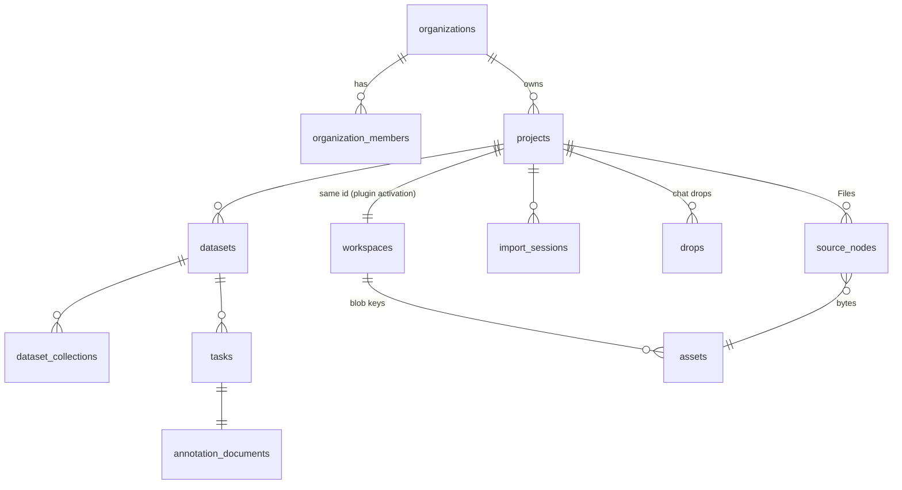

# First run: an empty product that fills up as you talk

**Goal.** A person signs in for the first time and sees an empty product: no projects, no
conversations, no files. One question, "What are you working on?", and a composer. They answer, or
drop files, and the assistant starts their first project. Everything that appears from then on is
theirs (or their organization's), and nobody else sees it. Sample projects exist, but only when the
person asks for one, and then as their own copy.

**Status (2026-11-02).** In progress on `todo14-api` and `todo14-web` (M0–M2), plus merged
`todo14-agent` (D9) and `todo14-seeds` (§3). Migrations landed as `0014`–`0016`. What the
full first-run journey still needs beyond this file is in `todo/todo15.md`.

**Why the product looks full today.** The empty states were built in todo13 (§3.1) and are on
`main`. Nobody sees them because every person is joined to a shared Samples organization holding
every seed project (§0). The fix is in data ownership, not in UI.

**Naming.** The product name appears only in `packages/contracts/src/naming.ts`. UI copy uses
`NAMING.displayName`; env vars are written here without their prefix.

---

## Start here (agents)

1. **Read, in order:**
   1. `AGENTS.md`;
   2. this file;
   3. `todo/todo13.md` §2 (D1, D14, D15) and §3.1 (the empty-state table you keep);
   4. `todo/todo9.md` §0.4 and Phases 2–5 (sign-in this builds on);
   5. `docs/deployment-gcp.md` ("Projects", "What the agent sees").
2. **Set up:** `git worktree add .worktrees/todo14-<name> -b todo14-<name> main`. Work only there.
3. **The data boundary holds** (`todo/todo13.md`, "Start here", point 3). Sample bytes are public
   data, but a person's copy of a sample is their project: the same rules apply to it as to an
   upload.
4. **Test the product yourself**, not through the in-house agent (`AGENTS.md`). "Is Home empty
   for a new person" is a browser check with a fresh dev principal, not a chat.
5. **Keep the e2e contracts** (`data-testid`s in todo13 §3.1, `user:local-expert` seeing the
   samples in dev, the seed-mode Vite stand-in).
6. **Hand back:** items done against exit tests, migrations, screenshots of each first-run screen,
   checks run, what's left.

---

## 0. Where we are (audit, 2026-11-01, `main`)

### 0.1 Why a new person never sees an empty state

| Cause | Where | Effect |
|---|---|---|
| Every `user:` principal is made an **editor** of the shared Samples org on first request | `kernel/projects.py` `ensure_principal` | All seed projects show on Home, Projects, the switcher, for everyone |
| Seeds are upserted into that org on every start | `ensure_seeds` / `ensure_seeds_once` | Wherever a seed manifest exists (always locally after `pnpm seeds`) |
| Without sign-in, every browser is the same person | `context.py` `resolve_context`, dev trust headers, default `user:local-expert` | Your second browser, a colleague, the deployed Studio: one shared history |
| The agent stores conversations under one owner | `apps/agent/src/runtime/sessions.ts` (`principal ?? "local"`) | Everyone shares one chat history |
| Samples are shared and **editable** | Samples org role `editor` | One person's labels on a sample are visible to every other person: a cross-tenant leak once real people exist |

Home already does the right thing when the list is empty (`HomePage.tsx`: composer, no Recent
projects). Projects, Overview, Files, Datasets, Studio and the chat drawer have the todo13 empty
states (`app/entry/empty-states.tsx`, `ComposerEmptyState`).

### 0.2 What is already right

- Home's composer creates a project on first send or drop, titles it from the goal, opens it with
  the assistant and delivers the message (`app/entry/HomeComposer.tsx`, `start-project.ts`).
- Projects belong to an organization (`projects.org_id`), and access is by membership
  (`require_project` → `role_in`). A project from someone else's org is a 404.
- Everything under a project hangs off `project_id`: Files (`source_nodes`), imports, drops,
  datasets, collections, structures, tasks, annotations, boots, proposals, Activity, Trash. So
  "per org" is already true for project data once the person is real.
- The kernel `workspaces` row is 1:1 with a project (todo6 D1), so plugin activation is per project
  too.

---

## 1. Principles

1. **Empty is honest.** A new person sees nothing that isn't theirs. No demo projects, no fake
   numbers, no "Sample" cards among their work.
2. **The first action is to talk or drop.** Home has one composer; every empty surface offers the
   same two actions (todo13 §3.1). Forms stay for people who want them.
3. **Samples are something you take, not something you're given.** "Try a sample" makes a private
   copy in your organization. Nothing you do to it is visible to anyone outside your organization.
4. **Everything has one owner.** Each row is owned by an organization (through its project) or by a
   person within an organization (conversations, resume points, stars). No "global" rows except the
   sample templates and the plugin registry.
5. **Dev stays usable.** `user:local-expert` keeps seeing the samples so the e2e suite and daily
   work don't change; any other dev principal starts empty.

## 2. Decisions

| # | Decision |
|---|---|
| D1 | **The tenant is the organization.** WorkOS organization = our `organizations` row (todo9 D4). Every person has a personal organization, created empty at first sign-in, shown as "<First name>'s workspace" (UI copy may say Workspace, glossary). |
| D2 | **Samples are opt-in copies.** The Samples org keeps the seed projects as **templates**; nobody is a member. "Try a sample" creates a new project in the caller's current org from a template: new `projects`, `workspaces`, `sources`, `source_nodes`, `datasets`, `dataset_collections`, `tasks` rows; `assets` rows pointing at the **same blob keys** (bytes are never copied; `asset_key` is the path, so two rows can share it). `projects.sample_of` records the template id; the card shows a "Sample" badge and the license. |
| D3 | **Dev principals.** In `dev` auth mode, principals listed in `API_SAMPLE_MEMBERS` (default `user:local-expert`) keep today's Samples membership (read-only `viewer` from now on, D7); every other principal starts empty. In `workos` mode the setting is ignored. |
| D4 | **Conversations belong to a person in an org.** Agent sessions carry `owner` (`user:<id>`) and `org_id`; lists filter by both. A conversation is about one project (sessions already require `projectId`); Home's composer creates the project first (todo13 D1). Org members don't see each other's conversations; they see each other's projects, files and Activity. |
| D5 | **Personal things stay personal within an org.** Resume points (`project_resume`), stars (`node_stars`), recents (`node_recent`), conversations, unsent drafts: keyed by person and project. Everything else in a project is shared with whoever can open the project. |
| D6 | **"Empty" is defined per org.** Home is empty when the current org has no non-archived projects the person can open. Switching org shows that org's state. An invited member who joins an org with projects never sees the empty Home, by design. |
| D7 | **Templates are read-only.** Samples-org memberships that remain (dev only) are `viewer`. Editing a sample means "Make a copy" (D2). Annotations already written on shared samples in dev stay; on GKE there are none to migrate (no real users yet). |
| D8 | **First-run hints, once.** After the first project opens, the assistant drawer's empty conversation shows the three todo13 prompts; nothing else (no tours, no checklists). Dismissed state is per person, stored server-side (`user_prefs`, Milestone 2), not in `localStorage`, so a second browser doesn't repeat it. |
| D9 | **Leaving and deleting.** Deleting an org deletes its projects (and everything under them, as today), its conversations in `spurby-ai` (by `org_id`), and the WorkOS org. Removing a member keeps their work in the org; their conversations there are deleted with their membership (they were private, D4). Milestone 3; documented now so tables carry `org_id` from the start. |

## 3. Where each kind of customer data lives

"Customer data" here is everything a person or organization puts in or creates. The patient-data
boundary (`docs/deployment-gcp.md`) decides the project; ownership decides the key.

| Data | Example | Lives in | Google project | Owned by (key) | Agent / model sees |
|---|---|---|---|---|---|
| Identity | name, email, avatar, MFA, sessions | WorkOS (US); mirrored in `users` (todo9 Phase 2) | WorkOS; mirror in `spurby-phi` Postgres | person (`user:<workos id>`) | ids only (`sub`, `org_id` in the token); never email or name |
| Organization and membership | org name, members, roles, invitations | WorkOS; mirrored in `organizations`, `organization_members` | WorkOS; mirror in `spurby-phi` | org | org id only |
| Projects | title, description, visibility | `projects`, `workspaces` | `spurby-phi` Postgres | org (`org_id`) | title, through the agent routes |
| File bytes | DICOM, PNG, CSV, ZIP members, video | `BlobStore` (Cloud Storage, CMEK) | `spurby-phi` | org, through `assets.workspace_id` = project | **never** |
| File metadata | names, folders, sizes, hashes, holds | `source_nodes`, `node_versions`, `fs_batches`, `fs_ops`, `assets` | `spurby-phi` Postgres | org, through `project_id` | ids, **screened** names, typed facts (todo13 D3) |
| Imports and drops | upload sessions, rights attestation, drop cards | `import_sessions`, `upload_files`, `drops`, `drop_plans` | `spurby-phi` Postgres | org, through `project_id`; `created_by` person | drop ids, states, screened names |
| Datasets and structure | definitions, collections, label structure | `datasets`, `dataset_collections`, `dataset_structures`, `proposals` | `spurby-phi` Postgres | org, through `project_id` | structure and counts, not contents |
| Tasks and environments | Studio config, label groups | `tasks`, `workspace_environments` (+ history), `task_studio_notes` | `spurby-phi` Postgres | org, through `project_id` | yes: this is the shell the agent edits |
| Annotations | boxes, labels, reviews | `annotation_documents`, `annotation_commits`, `versioned_annotation_payloads` | `spurby-phi` Postgres | org, through the task's project | filtered view only (`docs/deployment-gcp.md`) |
| Dataset versions | snapshots, exports | `apps/versioning` (`dataset_repos`) + Cloud Storage | `spurby-phi` | org, through `project_id` | no checkout (`/v1/commands` blocks it) |
| Personal state | resume, stars, recents | `project_resume`, `node_stars`, `node_recent` | `spurby-phi` Postgres | person + project | no |
| Conversations | messages, run events, artifacts, tool calls | agent store (`agent_sessions`, `agent_runs`, `agent_run_inputs`) + Redis run-event bus | `spurby-ai` (Cloud SQL, Memorystore) | person + org (`owner`, `org_id`, D4) | yes: it is the transcript. Holds ids and screened names only, never bytes or thumbnails |
| Model calls | prompts, completions | Vertex AI | `spurby-ai` | not stored by us beyond the transcript | — |
| Audit | who did what | `plugin_audit` and the kernel's audit records; Cloud Audit Logs to a locked bucket | `spurby-phi` | org, through `project_id` | no |
| Sample templates | public seed datasets | `seed-data/` locally; `spurby-data` on Google Cloud; Samples org rows | `spurby-data` (bytes), `spurby-phi` (rows) | nobody (templates) | as any project, once copied |
| Sandboxes | agent code execution | Daytona | outside both | none: no customer bytes ever (`AGENTS.md`) | — |

Two consequences:

- **Deleting an org touches two Google projects and WorkOS.** `spurby-phi` (projects cascade),
  `spurby-ai` (conversations by `org_id`), WorkOS (org, memberships). That's why D9 needs `org_id`
  on agent rows now.
- **Sample copies live in `spurby-phi` like any project.** A sample copy's blob keys point at
  sample bytes. On Google Cloud those bytes must be readable by the api in `spurby-phi`; copy the
  sample set once into a `samples/` prefix of the phi bucket at deploy time (public data, no
  boundary issue), rather than reading `spurby-data` from inside the perimeter.

## 4. Design: the first visit

### 4.1 The screens, in order

1. **Sign-in** (AuthKit hosted page, todo9 Phase 3). Returns to `/`.
2. **Home, empty.** The todo13 composer, unchanged copy:

   > **What are you working on?**
   > Drop files here, or describe it: "Label 200 chest X-rays as normal or pneumonia."
   > [ attach ]                                                   [ Send ]
   > Examples: Segment liver CT · Classify skin lesions · Annotate ultrasound video

   Below it, one quiet line instead of Recent projects: **"Or try a sample project"** → a small
   picker (title, modality, license) of the templates. `data-testid`: `home-composer` (keep),
   `try-sample`.
3. **Sidebar, empty.** No project switcher entries, no conversations. The org switcher shows
   "<First name>'s workspace". Projects, Plugins and Settings stay reachable.
4. **First send.** The composer creates the project (title from the goal), opens Overview with the
   assistant drawer and delivers the message (todo13 D1, as today). The drawer streams the
   assistant's plan; the project shows the todo13 empty states until files arrive.
5. **First drop.** As todo13 §3.2: the project is created, files land in Files ("Shared in
   chat/<conversation>"), the Studio opens on the first ready item.
6. **Coming back.** Home shows Recent projects and Resume, as today. The empty state never
   returns unless every project is archived or deleted.

### 4.2 Surfaces and their empty states

In-project surfaces keep todo13 §3.1's copy and test ids. Outside a project:

| Surface | Empty when | Shows | `data-testid` |
|---|---|---|---|
| Home | current org has no open projects | composer + "Or try a sample project" | `home-composer`, `try-sample` |
| Projects `/projects` | same | the same composer (todo13 §3.1, already shared) | `home-composer` |
| Sidebar conversations | person has no conversation in this org | nothing (no heading) | — |
| Org switcher | one org | the personal org name, "Create organization" | `workspace-switcher` (keep) |
| Settings › Team & Access | only you | "Invite people to work on your projects" + invite | `members-empty` (new) |
| Settings › API keys | none | "No keys yet" + Create | `keys-empty` (new) |

### 4.3 Samples

- The picker lists templates from the seed manifest with `status: available` and a license that
  allows it (`restricted` templates only in `dev`, as today's "Local dev only" badge).
- "Use this sample" → `POST /v1/projects/from-sample {sampleId}` → the new project's Overview.
  Copies are ordinary projects: rename, add files, delete. Badge "Sample" and the license line
  stay (from `sample_of`).
- A second "Use this sample" makes a second copy (titles get " (2)").

## 5. Data structure

### 5.1 Today

`organization_members.principal` is a free string (`user:local-expert`); there is no `users`
table. The agent's `agent_sessions` (other database, other Google project) has `owner` and
`project_id` but no `org_id`.

### 5.2 Changes

| Change | Where | Milestone | Notes |
|---|---|---|---|
| `ensure_principal` creates the personal org only; Samples membership only for `API_SAMPLE_MEMBERS` (D3), as `viewer` (D7) | `kernel/projects.py`, `config.py` | M0 | Fixes the "full" state without sign-in |
| `projects.sample_of` (nullable, template id); `project_dict.sample` = `seed or sample_of is not None`, license from the template | api migration `0013_sample_copies` (or after todo9's `0013_accounts`, whichever lands first) | M1 | |
| `POST /v1/projects/from-sample` → `kernel/samples.py` `copy_sample(db, ctx, sample_id)`: copy rows, share blob keys, one transaction, audit `project.created` with `sampleOf` | api | M1 | Reuse `ensure_seeds`' row building; keep both in one module |
| Sample bytes on Google Cloud under the phi bucket's `samples/` prefix | `tools/fetch-seeds.py` upload step, deploy runbook | M1 | §3, second consequence |
| `users`, org and membership WorkOS columns | todo9 Phase 2 | M2 | |
| `agent_sessions.org_id` + index (`owner`, `org_id`); owner from the verified user | agent store migration, `sessions.ts` | M2 | todo9 Phase 5 |
| `user_prefs` (`principal`, `key`, `value`, `updated_at`) for D8 | api migration | M2 | small, generic |
| Org deletion across api, agent and WorkOS | api + agent route | M3 | D9 |

Nothing else changes shape: every project-scoped table already keys on `project_id`, and the org
boundary is `require_project`.

## 6. Milestones

### Milestone 0. Empty for anyone but the dev person (no sign-in needed, about 1 day)

- [ ] `ensure_principal`: Samples membership only for `API_SAMPLE_MEMBERS` (D3), role `viewer` for
  new memberships; a one-off data migration turns existing Samples `editor` rows into `viewer`.
- [ ] Dev account menu: **"Start as a new person"** (dev mode only) sets a random
  `user:dev-<id>` principal in session storage; the web `fetch` wrapper and the Vite agent proxy
  send it as `X-Dev-Principal`. "Back to local-expert" undoes it. This is how you see the first
  run locally until sign-in exists.
- [ ] Home: replace "Recent projects" with nothing when empty (already), and add the
  `try-sample` line hidden until M1.
- [ ] Tests: api unit (new principal sees zero projects; `user:local-expert` sees the samples;
  viewer can't write a sample); e2e `first_run_test.py` (fresh principal → empty Home, empty
  sidebar, composer present; screenshot).

**Exit:** a fresh dev principal sees the empty Home and the todo13 empty states; existing e2e
tests pass unchanged.

### Milestone 1. Samples as copies (about 2 days)

- [ ] `sample_of` migration, `copy_sample`, `POST /v1/projects/from-sample`, the picker on Home and
  Projects.
- [ ] Sample bytes reachable on Google Cloud (§3); restricted templates hidden outside dev.
- [ ] Tests: copy is in the caller's org; labels on a copy are invisible to another principal;
  deleting a copy doesn't touch the template or other copies' bytes; `files/download` and the
  Studio read the shared blobs.

**Exit:** two dev principals each copy the same sample, label it, and see only their own labels.

### Milestone 2. Real people (after todo9 minimum sign-in, about 2 days)

- [ ] Personal org on first sign-in, empty (todo9 Phase 3 bootstrap).
- [ ] Agent conversations by owner and org (todo9 Phase 5, §5.2).
- [ ] `user_prefs` and the first-run hint dismissal (D8).
- [ ] Settings empty states from §4.2.
- [ ] Tests: two signed-in people in different orgs (Emulate) see nothing of each other: projects,
  files, drops, datasets, project Activity, conversations, run events; an invited member sees the org's
  projects but not the inviter's conversations.

**Exit:** journeys F1–F6 (§7) pass against Emulate in tests, and once by hand on the GKE stage
against WorkOS staging.

### Milestone 3. Leaving (later, about 2 days)

- [ ] Delete organization (Settings › Organization): projects cascade in `spurby-phi`,
  conversations by `org_id` in `spurby-ai`, WorkOS org; audit row; 30-day grace like Trash.
- [ ] Member removal deletes their conversations in that org (D9).

## 7. Journeys

| # | Start | Expect |
|---|---|---|
| F1 | New person signs in | Empty Home: composer, "Or try a sample project", empty sidebar, personal org name in the switcher |
| F2 | F1, types "Chest X-ray classification with five labels" | Project created in the personal org; todo13 J2 from there |
| F3 | F1, drops 30 PNGs | todo13 J1 |
| F4 | F1, Try a sample | A copy in the personal org, badge Sample, license line; Studio opens |
| F5 | Second person, other org | Sees none of F2–F4's projects, files, drops or conversations, by UI and by API (404s) |
| F6 | First person invites the second into their org | Second person sees the projects, not the first person's conversations |
| F7 | Dev, `user:local-expert` | Samples visible as today (read-only); e2e suite unchanged |

## 8. Config and rollout

| Key | Service | Default | Meaning |
|---|---|---|---|
| `API_SAMPLE_MEMBERS` | api | `user:local-expert` | Dev principals that keep Samples membership (ignored in `workos` mode) |
| `API_SAMPLES_ENABLED` | api | `1` | Show "Try a sample" and allow `from-sample` |

Rollout: M0 and M1 go to the GKE stage as soon as they merge (only synthetic and public data
there). M2 ships with todo9's GKE flip. No customer uploads until todo12 A9 (perimeter enforced),
regardless of sign-in.

## 9. Open questions

1. Should a brand-new org get one sample copied automatically, labelled as such? This plan says no
   (Principle 1); revisit if the first-run drop-off is high.
2. Team orgs: does creating a team org (not personal) also start empty, or offer "move projects
   from your personal workspace"? Proposed: empty, plus a "Move to…" action on project cards
   later.
3. Conversation sharing inside an org ("share this chat with the team") is out of scope; D4 keeps
   them private.
